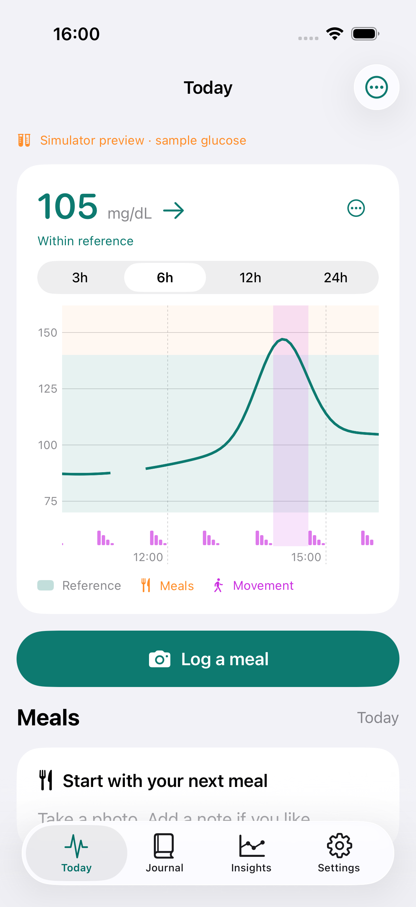

# Glance cleanup — 4271

- Fresh Watch complications show glucose and trend without a status glyph above the value. Hidden/stale states remain explicit. Calibration provenance stays in the payload, VoiceOver and the Watch app; this is a presentation change only.
- Today uses one **Reference · Meals · Movement** legend. Removed the repeated numeric range, information button and separate row. Reference details remain in **Chart options → About readings**. The legend adapts vertically when text cannot fit horizontally.
- [Guava assessment](GUAVA_INTEGRATION.md): Apple Health bridge recommended for validation; no new sharing enabled.

Validation: iPhone simulator build and signed combined iPhone/Watch build passed. Existing chart-visibility and chart-options journeys passed (2/2); inspected the fresh/stale screenshots and retained information screen. No sensor, persistence or notification-policy changes. Watch complication changes compiled; on-face rendering has not been visually verified in this pass.

Device acceptance (14 November 2026): installed and launched 4271 on the physical iPhone and Apple Watch Ultra; read back both versions. The Watch snapshot and complication cache matched the phone's latest reading. All 6,115 pre-update readings, sensor records, meal files and saved adjustments were unchanged. The existing sensor connection resumed without starting a new session. The only changed Application Support file was the expected WatchConnectivity application context.

