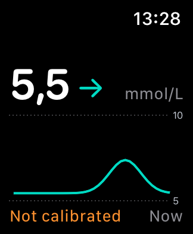
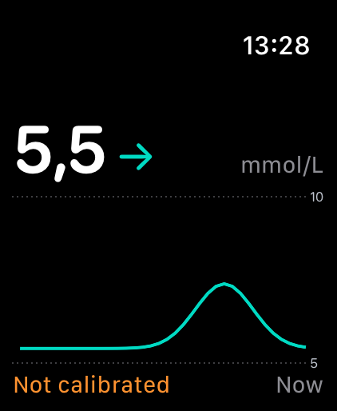
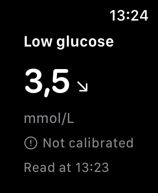

# Watch review — 4270

The Watch remains a glance at **glucose → recent curve → last meal**. Sensor setup, calibration entry, food photography and detailed sleep/activity analysis belong on iPhone. The Watch receives readings from the phone; it does not connect directly to the sensor.

## Changes

- Preserve SmartGuide’s uncalibrated provenance across the phone snapshot, Watch cache, complications and expanded notifications. Show **Not calibrated** without hiding the glucose or trend. Small complications use a status symbol and an explicit VoiceOver label. Older payloads remain readable.
- Handle SwiftUI WatchConnectivity background tasks. Wait for session activation and pending delivery to finish before returning, using the existing delegate/cache/widget path. Respect cancellation; no polling, extra alerts or new sensor connection.
- Replace “Response pending” with **Waiting for readings**, simplify the observation countdown, and shorten the meal empty state to **Log a meal on iPhone**.
- Fit the status into the existing chart footer. Screenshot review caught a wrapped label on 40 mm; the final label stays on one line. No extra settings or Connection page.

## Review coverage

| Area | Evidence |
| --- | --- |
| Glucose, arrow, units, chart | Simulator journeys in mmol/L and mg/dL, including uncalibrated readings; chart and status visibility assertions |
| Touch and Digital Crown | Forward/back navigation, last-content boundary, long meal title and accessibility text on 40 mm and 49 mm |
| Meals | Ready, collecting, insufficient data, overlap and empty states; countdown never turns a cached response into a completed observation |
| Stale and missing readings | Current value/arrow disappear; previous value is labelled historical; actionable empty state |
| Privacy | Full health view replaced in dimmed/Always On fixture; complications and notifications remain privacy-sensitive |
| Notifications | Fresh, stale, missing and uncalibrated fixtures; short titles, reading time, existing actions/policy retained |
| Complications | Four family code paths, default sharing preference, stale timeline and payload ordering reviewed; compiled with the app |
| Compatibility | Optional payload/cache field, legacy decoding and notification provenance tests; no database, pairing or identifier changes |

The seven Watch journeys were exercised on both simulator sizes. The chart test initially failed after adding the status, then passed after the layout correction. Screenshots were inspected; Crown tests use native rotation events, not swipes. All 126 Foundation package tests passed. Combined signed iPhone/Watch and Watch simulator builds passed.

**Hardware boundary:** the physical Watch was unreachable during this review. Background delivery/cancellation, complications on real faces, mirrored notifications and the physical Crown’s feel still need device acceptance. Simulator screenshots and compilation do not prove these. This review does not claim build 4270 is installed on either physical device.

## Design sources

Apple recommends short, focused Watch interactions, shallow navigation and native Crown scrolling: [Designing for watchOS](https://developer.apple.com/design/human-interface-guidelines/designing-for-watchos). Labels use plain language and omit unnecessary explanation: [Writing](https://developer.apple.com/design/human-interface-guidelines/writing). Glucose and trend take priority on the face: [Complications](https://developer.apple.com/design/human-interface-guidelines/complications).

Background task completion follows [Using background tasks](https://developer.apple.com/documentation/watchkit/using-background-tasks) and [Watch Connectivity transfers](https://developer.apple.com/documentation/watchconnectivity/transferring-data-with-watch-connectivity). Actual delivery timing remains controlled by watchOS.

## Screenshots

Synthetic simulator data only.

| 40 mm glucose | 49 mm glucose | Watch notification |
| --- | --- | --- |
|  |  |  |
